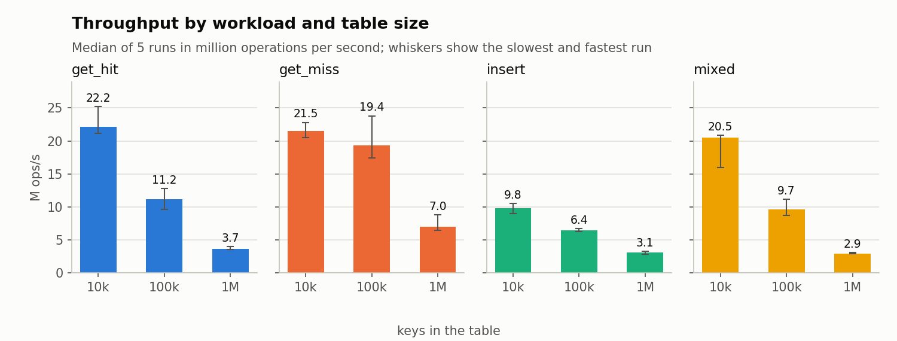
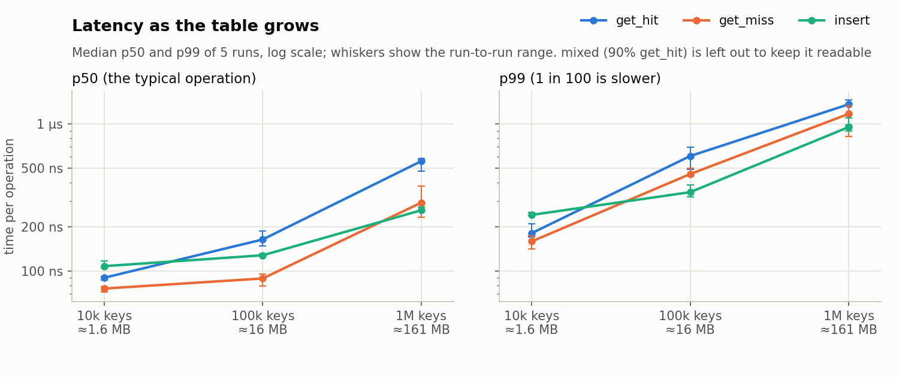
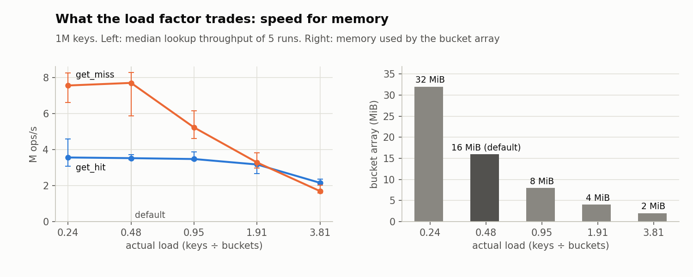
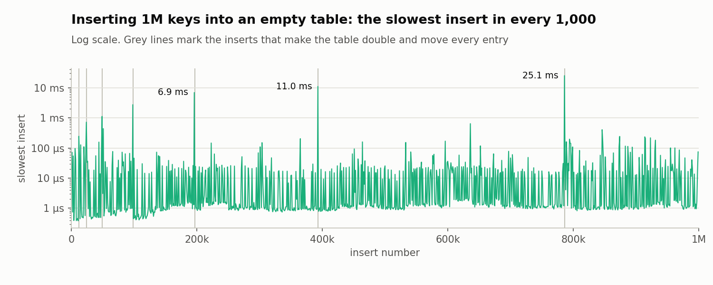

# In-Memory Key-Value Store

[](https://github.com/MZain06/In-Memory-Key-Value-Store/actions/workflows/ci.yml)

A hash-table key-value store in C11: separate chaining, power-of-two resizing and an opaque public API, plus a benchmark harness that measures throughput and p50/p99 latency over repeated runs and plots the results.



**Headline:** at 1M keys, lookups run at 3.7M per second with a p99 of 1.4 µs on a laptop, about 6× slower than at 10k keys because the table no longer fits in the CPU cache. [Results](#results) has all four charts and what each one shows.

## Quick start

On Ubuntu 24.04, including under WSL2 on Windows:

```bash
sudo apt install build-essential clang clang-format cppcheck valgrind \
    libclang-rt-18-dev python3-pandas python3-matplotlib
git clone https://github.com/MZain06/In-Memory-Key-Value-Store.git
cd In-Memory-Key-Value-Store
make test examples
```

`make test examples` needs only gcc and make. The rest is for `make check` (everything CI runs), building with clang, and drawing the benchmark charts.

| Command | What it does |
| --- | --- |
| `make check` | Runs every check that CI runs |
| `make test` | Builds and runs the unit tests |
| `make asan` | Runs the tests under AddressSanitizer and UBSan |
| `make valgrind` | Runs the tests under Valgrind |
| `make examples` | Builds and runs the example programs |
| `make bench` | Builds the benchmark with `-O2 -DNDEBUG` |
| `make bench-smoke` | Runs a tiny benchmark, normally and under Valgrind |
| `make format` | Formats the code with clang-format |
| `make format-check` | Fails if any file is not formatted |
| `make lint` | Runs cppcheck static analysis |
| `make clean` | Deletes the `build/` folder |

Use `make CC=clang test` to build with clang instead of gcc.

## Using the API

```c
#include "kv.h"

kv_store *store = kv_create(NULL);
kv_put(store, "language", "C11", 3);

const void *value;
size_t len;
if (kv_get(store, "language", &value, &len) == KV_OK) {
    printf("%.*s\n", (int)len, (const char *)value);
}

kv_destroy(store);
```

`include/kv.h` documents the full contract, and `examples/basic.c` is a complete program.

## Design

```text
kv_store
  buckets -> [0] -> NULL
             [1] -> entry -> entry -> NULL
             [2] -> NULL
             [3] -> entry -> NULL
             ...   (capacity is a power of two: 8 at the start)

entry (48 bytes)
  next       -> the next entry in the same bucket, or NULL
  hash          the key's 64-bit FNV-1a hash, stored so it's never recomputed
  key        -> a copy of the key, in its own allocation
  key_len
  value      -> a copy of the value, in its own allocation
  value_len
```

- **Hash function: 64-bit FNV-1a.** It's a few lines of code and fast on short keys, and it spread the benchmark keys evenly: the longest chain at 1M keys was 8 entries. It isn't safe against keys chosen to collide (see [Limitations](#limitations-and-next-steps)).
- **Bucket index: `hash & (capacity - 1)`.** The capacity is always a power of two, so a mask replaces a division.
- **Stored hashes.** A lookup compares the stored hash before any key bytes, so other keys in the same bucket almost never cost a string comparison, and resizing never rehashes a key.
- **Chains.** `find_link` returns a pointer to the link that points at the matching entry, or to the empty link at the end of the chain, so deleting the first entry of a chain needs no special case. New keys go on the front of their chain, which `kv_put` has already walked to check the key isn't there.
- **Resize policy.** The table doubles when its size passes capacity × 0.75 (the load factor is configurable) and halves when the size falls below a quarter of that limit, never going below its starting capacity; the gap stops it flip-flopping around one size. On a doubling, each entry stays in bucket *i* or moves to *i* + the old capacity, depending on one more bit of its stored hash. If the bigger array can't be allocated, the table keeps the old one and carries on with longer chains, so no data is lost.
- **Ownership and pointer lifetime.** `kv_put` copies the key and value, so callers can free their own buffers straight away. A value pointer from `kv_get` stays valid until that key is overwritten or deleted, or the store is destroyed: resizing relinks entries without copying them.
- **No half-done updates.** `kv_put` makes its copies before changing the table, so `KV_NO_MEMORY` always leaves the store unchanged, and overwriting a key with a value read from the same store is safe.
- **Opaque handle.** `kv.h` only declares `kv_store`, so its layout can change (to open addressing, say) without breaking callers.

## Testing

- `tests/test_kv.c`: unit tests for every API function, covering edge cases (empty keys and values, zero bytes inside values, 1 KB keys), long chains, resizing and pointer stability.
- `tests/test_model.c`: a randomised model-based test. It runs 3 million random puts, gets and deletes against a simple array model and checks every result. One run alternates filling and emptying phases so the table resizes over 200 times; another uses a load factor of 4 to force long chains.

The random test uses a fixed seed (42), so every run is reproducible. A failure names the operation and the seed. After `make test`, replay a seed or try a new one with:

```bash
./build/debug/bin/test_model 1234
```

CI runs every test with gcc and clang, under AddressSanitizer and UBSan, and under Valgrind. Tests use [Unity](https://github.com/ThrowTheSwitch/Unity) v2.7.0, vendored in `tests/unity/`.

## Benchmarks

`bench/bench.c` measures four workloads at 10,000, 100,000 and 1,000,000 keys:

| Workload | What it measures |
| --- | --- |
| `insert` | Building a table from empty, including every resize |
| `get_hit` | Looking up keys that exist, in random order, and reading the value |
| `get_miss` | Looking up keys that don't exist |
| `mixed` | 90% lookups and 10% overwrites of existing keys |

Each configuration runs once to warm up, then 5 measured runs. Every run builds its own table and makes two passes over the same 5 million operations: one timed as a whole for throughput, and one that times each operation for p50, p99 and p99.9 latency. Keys and lookup orders come from a fixed seed and are generated before timing starts, every page of memory is touched beforehand, and every pass checks its own results. The cost of the timer itself is measured at startup and recorded in every row.

The published results come from one laptop: an Intel Core Ultra 9 185H (16 cores, 6 of them performance cores, 22 threads and a 24 MiB L3 cache) running Ubuntu 24.04 under WSL2 with 15 GiB of memory, built with gcc 13.3 and `-O2 -DNDEBUG`. [results/env.txt](results/env.txt) has the full details. To reproduce them, run:

```bash
./scripts/run_bench.sh
python3 scripts/plot.py
```

The script builds with `-O2 -DNDEBUG`, pins the benchmark to one CPU, records the machine in `results/env.txt`, adds a load-factor sweep (0.25 to 4) at 1M keys, and records the slowest insert in every 1,000 while building a 1M-key table. It takes about 10 minutes. `plot.py` draws the charts below and writes `results/summary.md`. To check a second run against the first, run `./scripts/run_bench.sh build/check`, then `python3 scripts/compare.py results/results.csv build/check/results.csv`.

## Results

Each number is the median of 5 runs, and [results/summary.md](results/summary.md) lists every median. A second full run matched these medians within 5% for 9 of the 12 tests and within 11% for all of them, and matched the load-factor sweep within 8%. Single runs vary much more (by up to ±29%, as the whiskers show), likely because the laptop mixes performance and efficiency cores and WSL2 can't choose which kind runs the benchmark.


**At 1M keys, a lookup that misses is 1.9× faster than one that hits** (7.0 vs 3.7 M ops/s). With 0.48 keys per bucket on average, most buckets are empty, so a miss usually stops at the bucket or after comparing one stored hash. A hit also has to follow pointers to the key, to compare it, and then to the value: separate allocations that are rarely in cache in a 161 MB table. At 10k keys, where the whole table fits in cache, hits and misses run at about the same speed.



**A typical lookup is 6.2× slower at 1M keys than at 10k.** The median `get_hit` takes 90 ns when the table is ≈1.6 MB and fits in cache, but 559 ns when it is ≈161 MB, over 6× the size of the L3 cache. Each lookup follows pointers through a bucket, an entry, a key and a value, so in a big table most of those steps are trips to main memory. The p99 grows with it, from 181 ns to 1.4 µs.



**The default load factor costs no measurable lookup speed and halves the bucket memory.** Because the table grows by doubling, the default maximum of 0.75 leaves 1M keys at an actual load of 0.48. There, `get_hit` runs at 3.52 M ops/s, the same within noise as the roomiest setting tested (3.56 at 0.24), with a 16 MiB bucket array instead of 32 MiB. Packing keys tighter costs more: at a load of 3.81 the array shrinks to 2 MiB, but `get_hit` loses 40% of its throughput and `get_miss` 78%. Misses lose the most because they check every entry in a chain while hits stop at their key, so misses lose their lead by a load of 1.91 and fall behind at 3.81.



**Each resize stalls one insert, and each stall is about twice as long as the last.** Building a 1M-key table resizes 18 times. The slowest insert took 25.1 ms, when the table doubled to 2,097,152 buckets and moved all 786,433 entries; the slowest insert in a typical window of 1,000 took 1.3 µs. Because each resize comes after twice as many inserts as the one before, the 18 resizes moved about 1.6 million entries in total, so the average cost per insert stays constant (amortised O(1)). Systems that can't accept a long pause, such as Redis, resize incrementally instead, moving a few buckets on each operation.

## Limitations and next steps

| Limitation | What I'd try next |
| --- | --- |
| Single-threaded: there's no locking, so a store can only be used from one thread at a time | One mutex, then a lock per group of buckets, measuring what contention each one costs |
| Three allocations per entry (entry, key and value): 144 bytes for a 16-byte key and a 32-byte value, and a pointer to follow for each | One allocation holding the entry, key and value together |
| Resizing moves every entry at once, so one insert took 25 ms | Incremental resizing that moves a few buckets on each operation, as Redis does |
| FNV-1a isn't keyed, so someone choosing the keys can make them all collide and turn lookups into list walks | A keyed hash such as SipHash, which Python and Rust use for this reason |
| Separate chaining costs a pointer to follow for every entry in a chain | Open addressing with linear probing behind the same `kv.h`, compared on all four workloads |
| Keys can't contain zero bytes, and nothing is saved to disk or reachable over a network | A key-length API, and a small TCP server speaking part of the Redis protocol |

## Project layout

```text
include/kv.h       the public API
src/kv.c           the hash table
tests/             unit tests, the model-based test and vendored Unity
examples/basic.c   a complete example program
bench/bench.c      the benchmark harness
scripts/           run_bench.sh, plot.py and compare.py
results/           the published CSVs, charts and machine details
```

## Licence

MIT: see [LICENSE](LICENSE).
